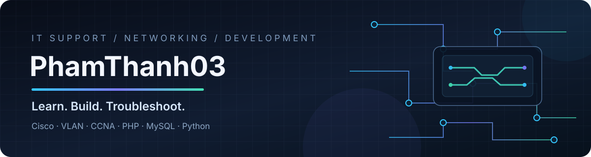

 

# 👋 Hi, I'm Thanh Phạm

### IT Support · Network Engineering · Web Development

**Building practical skills in networking, systems, and web applications.**

---

## 🙋‍♂️ About Me

- 🖥️ Interested in **IT Support, system administration, and network engineering**.
- 🌐 Learning networking fundamentals: **TCP/IP, VLANs, switching, routing, and troubleshooting**.
- 📘 Studying toward **CCNA** and practicing network labs with Cisco Packet Tracer.
- 💻 Building web projects with **PHP, MySQL, HTML, CSS, JavaScript, and Bootstrap**.
- 🐍 Exploring **Python, Linux, Git, and automation**.
- 🎯 My goal is to turn what I learn into practical projects and clear technical notes.

## 🧰 Tech Stack

### Networking & Systems

### Web Development & Tools

## 🚀 Featured Projects

<table>
  <tr>
    <td width="50%" valign="top">
      <h3>📱 Phone Warranty Management</h3>
      
A web app concept for managing customers, phone details, IMEI numbers, and warranty periods.

      

        
        
        
      

      Suggested repository: <code>phone-warranty-management</code>
    </td>
    <td width="50%" valign="top">
      <h3>🌐 Cisco Network Labs</h3>
      
Hands-on notes and labs covering VLANs, trunking, inter-VLAN routing, STP, and troubleshooting.

      

        
        
        
      

      Suggested repository: <code>network-labs</code>
    </td>
  </tr>
  <tr>
    <td width="50%" valign="top">
      <h3>🧑‍💻 Web-ByMe</h3>
      
A personal web development project exploring login sessions, file uploads, and a Bootstrap gallery.

      

        
        
        
      

      Suggested repository: <code>Web-ByMe</code>
    </td>
    <td width="50%" valign="top">
      <h3>📝 Technical Notes</h3>
      
Short guides, troubleshooting notes, command references, and learning summaries.

      

        
        
      

      Suggested repository: <code>technical-notes</code>
    </td>
  </tr>
</table>

> **Note:** These are project descriptions based on your learning and project interests. Create the repositories and update this section with real links when they are ready. Don't present unfinished work as completed.

## 📊 GitHub Dashboard

 

## 🗺️ Learning Roadmap

- [ ] CCNA: network fundamentals and IPv4 subnetting
- [ ] VLANs, trunking, STP, and EtherChannel
- [ ] Inter-VLAN routing, ACLs, and network security fundamentals
- [ ] Linux fundamentals and system administration
- [ ] Improve PHP/MySQL projects and document setup steps
- [ ] Practice Git workflows and publish project updates

## 📫 Connect

> Add a public email or other social links here only if you want them visible.

---

**⭐ Thanks for visiting my profile!**

Learning consistently · Building practical skills · Sharing progress

